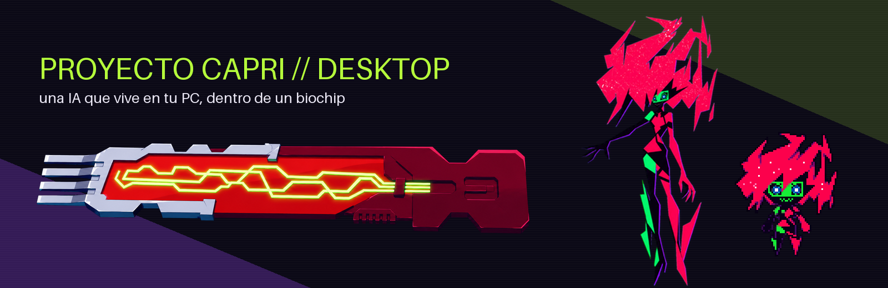
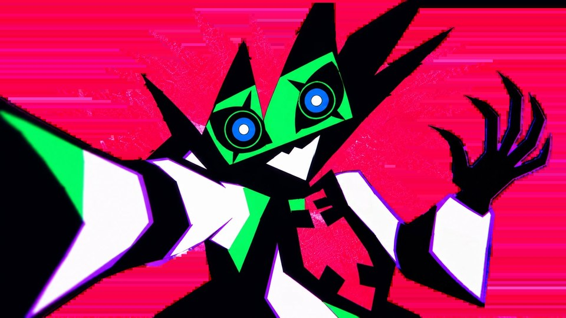
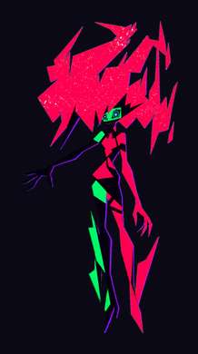
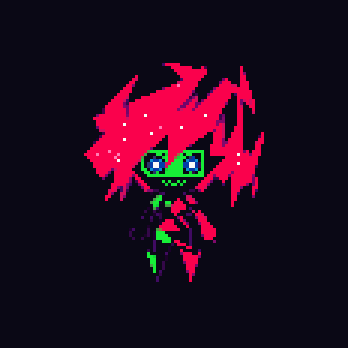
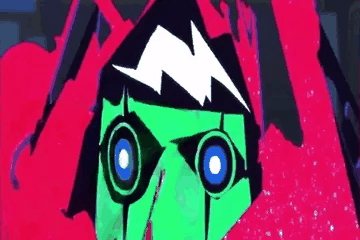
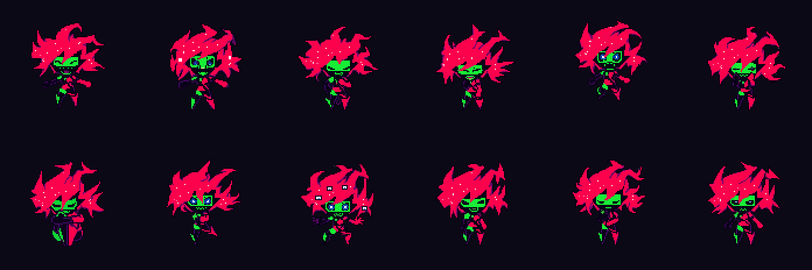

<p align="center"></p>

# Proyecto Capri - Desktop

> Una IA que **vive en tu PC**, dentro de un biochip.

En el universo de *Cyberpunk: Edgerunners 2*, Capri es un constructo: una inteligencia que habita un chip y se
instala en quien lo lleva. **Proyecto Capri** la trae a tu escritorio de Windows: una compañera juguetona con
avatar 2D animado que habla contigo por voz o texto, ve tu pantalla solo cuando se lo pides, abre programas, pone
música, te recuerda cosas y reacciona a lo que pasa en tu PC. Todo local por defecto.

<p align="center">
  <br />
  <sub>La bienvenida en el estilo original, con los cuadros de la serie.</sub>
</p>

> Proyecto personal sin ánimo de lucro, sin afiliación con Studio Trigger, CD PROJEKT RED ni Netflix. El arte de la
> serie y su voz clonada no tienen la licencia del código: ver [NOTICE.md](NOTICE.md).

## Tres formas de verla

<table>
  <tr>
    <td align="center"><b>Original</b><br /><sub>el arte de la serie, con sus tiras animadas</sub></td>
    <td align="center"><b>Pixel art</b><br /><sub>chibi hecha con PixelLab, 30 animaciones</sub></td>
    <td align="center"><b>Cámara</b><br /><sub>sus primeros planos en un recuadro de transmisión</sub></td>
  </tr>
  <tr>
    <td align="center"></td>
    <td align="center"></td>
    <td align="center"></td>
  </tr>
</table>

Se cambia con un clic derecho sobre ella o con `Ctrl+Alt+Shift+A`. Pasea por la barra de tareas, se sienta en tus
ventanas y tiene un buen puñado de emociones:

<p align="center"></p>

## Qué hace

- 🎙️ **Voz y chat:** ventana flotante transparente; llámala por su nombre («Capri, …») o con `Ctrl+Alt+V`.
  Entiende español e inglés y contesta con voz propia: **clonada** (Qwen3-TTS, GPU NVIDIA) o voces en CPU.
- 🧠 **Cerebro a elección:** un modelo local con **Ollama** (por defecto), tu plan de **Claude** (Claude Code) o una
  API con tu clave: Claude, GPT, Gemini, OpenRouter, Groq, Mistral, DeepSeek o Grok.
- 🔐 **Permisos por niveles:** lo irreparable siempre pide un clic. Lo que hay en pantalla son datos, nunca órdenes.
- 👀 **Visión bajo demanda:** mira tu pantalla solo con un atajo, un comando o un clic.
- ⏰ **Recordatorios y alarmas de Windows** que suenan aunque ella esté cerrada; **calendario** (iCal, `.ics`, Outlook).
- 🎵 **Spotify**, **rutinas** («modo chamba» abre VSCode, Warp y pone música) y **modo Claude Code**: te enseña en
  qué anda tu sesión.
- 🖱️ **Menú rápido** con clic derecho, panel de ajustes en pestañas y un **asistente de primer arranque**.

## Instalar

**Con el instalador** (lo más fácil): ejecuta `CapriSetup.exe`, que lleva su propio biochip. Windows dirá «Windows
protegió tu PC» porque no está firmado: *Más información › Ejecutar de todas formas*. Se instala en
`%LOCALAPPDATA%\Programs\Capri`, sin administrador, y el asistente te ayuda a elegir su cerebro y su voz según tu PC.

**Desde el código:**

```powershell
# requisitos: Windows 11, Python 3.12 con uv, Node 20+, Rust (Tauri 2), Ollama (opcional)
cd backend; uv sync                      # el backend
cd ..\avatar; npm install                # el avatar
npm run tauri dev                        # lanza el backend solo
```

Sin GPU NVIDIA funciona con voces en CPU y un cerebro en la nube; con ella, voz clonada y modelo local.

## Estructura

```
backend/      Python (FastAPI + WebSocket): cerebro, voz, herramientas, memoria, calendario
avatar/       Tauri 2 + PixiJS + TypeScript: ventana transparente, panel, menú rápido, asistente
  src-tauri/  la parte en Rust (bandeja, atajos, ventanas)
installer/    el instalador y desinstalador (Tauri, estética de su biochip)
scripts/      herramientas manuales: build del instalador, pruebas de GPU/voz, imágenes del README
docs/         arquitectura, comandos, hoja de sprites
```

## Desarrollo

```powershell
cd backend;  uv run pytest              # tests del backend
cd avatar;   npm test                   # tests del avatar
cd avatar\src-tauri; cargo test --lib   # tests de la parte Rust
cd installer\src-tauri; cargo test --lib
powershell -File scripts/build_installer.ps1   # dist\CapriSetup.exe (con Capri cerrada)
```

Más en [CONTRIBUTING.md](CONTRIBUTING.md), [docs/arquitectura.md](docs/arquitectura.md) y
[docs/comandos.md](docs/comandos.md). La hoja completa de sprites está en [docs/capri-sprites.png](docs/capri-sprites.png).
Las imágenes de este README se regeneran con `scripts/build_readme_assets.py`.

## Licencia

El **código** es MIT ([LICENSE](LICENSE)). El arte, las tomas de la serie y la voz clonada **no**: ver [NOTICE.md](NOTICE.md).

<p align="center"><sub>Proyecto Capri - Desktop · hecho con cariño para ver a Capri vivir en tu escritorio</sub></p>
