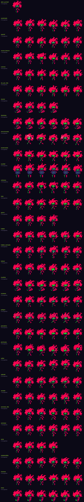

# Capri · hoja de sprites

Capri es una mascota de escritorio en pixel art **generada por código**: no hay imágenes sueltas, sino un muñeco articulado (`avatar/src/pet/`) que se dibuja en cada fotograma. Así cada animación tiene tantos pasos como haga falta, las transiciones son suaves y se pueden añadir estados nuevos sin dibujar fotogramas a mano.

- **Lienzo:** 80×96 px nativos, ampliados ×3 sin suavizado (240×288 en pantalla). La línea de suelo está a 18 px del borde inferior: ahí se sienta, sobre la barra de tareas, con las piernas colgando.
- **Ritmo:** 20 fps. Al cambiar de estado, la postura se mezcla durante 320 ms.
- **Paleta cerrada** (`stamps.ts`): contorno `#140a14`, pelo `#b82060`/`#861445`, piel `#3fe07c`, traje `#a61a4c`/`#6c0f30`/`#1f1622`, iris `#2f7dff`, más los colores de efectos (rosa, amarillo, cian, rojo).
- **Cómo se dibuja:** cada pieza (pelo, piernas, torso, brazos, cabeza, flequillo) se pinta con formas en su propia capa. Luego se pasa a píxeles duros con los colores de esa pieza y recibe su contorno negro de 1 px. La cara y los efectos son sellos de píxeles dibujados a mano.
- **Revisión en vivo:** con `npx vite` corriendo en `avatar/`, abre `http://localhost:1420/preview.html`; añade `?live` para ver todo animado, `?only=feliz,triste` para filtrar y `?scale=4` para ampliar.

## Estados

| Estado (`id`) | Qué hace | Cuándo | Duración |
|---|---|---|---|
| `sentada` | Sentada en el borde, balancea las piernas, respira, mira al ratón | Reposo por defecto | bucle |
| `meditar` | Flota con las piernas cruzadas, sube y baja, la sombra se encoge | Reposo: 20 % de los turnos de 25 s | bucle |
| `estirarse` | Sube los brazos, se estira y bosteza | Reposo: 15 % de los turnos | 2,6 s |
| `dormir` | Piernas cruzadas, cabeza caída, respiración lenta, zZz | 3 min sin hablar, o sin conexión | bucle |
| `saludar` | De pie, agita la mano | Al conectar con el backend | 1,8 s |
| `escribir` | Teclea en un portátil sobre el regazo; a ratos se para a pensar (…) | Mientras el modelo piensa | bucle |
| `hablar` | De pie, gesticula con una mano | Emoción `neutral` | bucle |
| `feliz` | Saltitos, ojos ^^, sonrisa con dientes, destellos | Emoción `feliz` | bucle |
| `enamorada` | Manos en las mejillas, ojos de corazón, rubor, corazones | Emoción `feliz` (variante al azar) | bucle |
| `emocionada` | Salta con los brazos arriba, ojos de estrella, sombra | Emoción `emocionada` | bucle |
| `traviesa` | Se tapa la boca y se ríe, guiño, mano en la cadera | Emoción `traviesa` | bucle |
| `curiosa` | Se agacha, ladea la cabeza, mano en la barbilla, "?" | Emoción `curiosa` | bucle |
| `pensativa` | Mano en la barbilla, mira arriba, puntos suspensivos | Emoción `pensativa` | bucle |
| `sorprendida` | Salta hacia atrás, ojos muy abiertos, "!", tiembla | Emoción `sorprendida` | bucle |
| `molesta` | Brazos cruzados, golpea el suelo con el pie, vena de enfado | Emoción `molesta` | bucle |
| `triste` | Abraza las rodillas, cabeza baja, lágrima | Emoción `triste` | bucle |
| `seria` | Manos a la espalda, mirada fija, asiente de vez en cuando | Emoción `seria` | bucle |
| `pinchada` | Se aplasta y se tambalea, ojos en espiral, estrellas | Clic sobre ella | 1,3 s |
| `acariciada` | Inclina la cabeza hacia la mano, ojos ^^, rubor, corazones | Pasar el ratón de lado a lado sobre su cabeza | mientras dure, +0,9 s |

Prioridad del director (`behaviors.ts`, `choose`): pinchada > acariciada > escribir > emoción (mientras habla y 15 s después) > dormir > saludar > reposo.

## Capas que se suman a cualquier estado

- **Gestos del modelo:** `asentir` (la cabeza baja dos veces), `ladear_cabeza`, `guino` (ojo derecho), `saltar` (salto con aplastamiento), `senalar` (brazo derecho estirado) y `cruzar_brazos`.
- **Habla:** mientras escribe el texto, la boca sigue las vocales: A, E/I, O/U y cerrada en signos de puntuación.
- **Parpadeo:** cada 2-6 s, si los ojos están abiertos.
- **Mirada:** los ojos abiertos siguen al cursor por todo el escritorio y vuelven a mirarte tras 4 s sin mover el ratón.
- **Glitch:** destello corto al cambiar de emoción.

## Ratón

La ventana deja pasar los clics al escritorio salvo justo sobre Capri, o mientras la barra de entrada está abierta. Rust sondea el cursor a unos 30 Hz contra la caja de sus píxeles opacos (`set_hitbox`).

## Cómo añadir un estado

1. Añade una entrada en `BEHAVIORS` (`avatar/src/pet/behaviors.ts`) con una función `pose(t, ctx)`. Parte de `standing`, `sitEdge` o `crossLegged` y coloca las manos con `hands()`, que usa IK.
2. Si hacen falta ojos, bocas o efectos nuevos, dibújalos como sellos en `stamps.ts` (una letra por píxel) o como efecto en `draw.ts`.
3. Decide cuándo se activa en `choose()` o en `EMOTION_BEHAVIOR`.
4. Regenera esta hoja: con `npx vite` corriendo en `avatar/`, ejecuta `uv run --project backend python scripts/export_sprite_sheet.py` desde la raíz.

## Clips de PixelLab (arte definitivo, en curso)

Las animaciones dibujadas con PixelLab (`avatar/assets/pet/anim/<clip>/<clip>_NN.png`) sustituyen a la mascota por código en los estados que ya las tienen:
- `avatar/src/pet/clips.ts` declara los clips (`CLIPS`: fotogramas, fps y si van en ida y vuelta) y a qué estado pertenecen (`SPRITE_FOR`).
- Al entrar en un estado con clips se reproduce su clip de entrada y luego el bucle. Al salir, el de entrada al revés; las reacciones al ratón cambian al instante.
- Los fotogramas se muestran a ×2, con los pies de su primer fotograma en la misma línea de suelo que la mascota por código. La zona de clic sale de los píxeles de cada fotograma.

| Estado | Clips | Vista |
|---|---|---|
| `sentada` | `sentarse` (9 fotogramas, 12 fps, una vez) → `sentada_idle` (7 fotogramas, 7 fps, ida y vuelta) | 3/4 |

**Para añadir un clip:**
1. Descárgalo con `scripts/fetch_pet_anim.py <clip> <urls…>`.
2. Añádelo a `CLIPS` y a `SPRITE_FOR`.

El plan completo y su estado están en `docs/arte-pixellab.md`.
